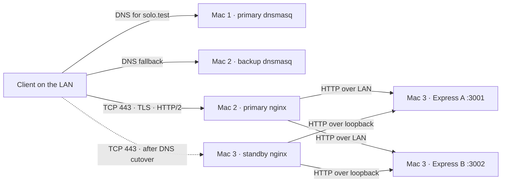

# Phase 2 architecture

This extends the [Phase 1 architecture](ARCHITECTURE.md). The IPs below were recorded in the current LAN session. Recheck them before deployment and update the DNS hosts files, primary nginx upstream, and firewall source address together if DHCP changes them.

| Mac | IPv4 | Services |
| --- | --- | --- |
| 1 / Abhi | `10.7.15.27` | Primary dnsmasq on `53/UDP` and `53/TCP`. Acts as the independent client for the firewall test. |
| 2 / Kevish | `10.7.3.98` | Primary nginx on `80/TCP` and `443/TCP`. Runs the backup dnsmasq on `53/UDP` and `53/TCP`. Holds the CA signing key. |
| 3 / Raghav | `10.7.21.8` | Express A and B on `3001/TCP` and `3002/TCP`. Hosts the temporary standby nginx on `80/TCP` and `443/TCP`, plus the Wireshark client. |

Both resolvers give a 30-second TTL and normally return Mac 2 for `app.solo.test` and `api.solo.test`. During cutover, both return Mac 3 for `app.solo.test` while `api.solo.test` continues to point to Mac 2. This gives the team a control name to check. The client resolver file scopes the two DNS servers to `solo.test`. Public DNS stays on the network's automatic settings.

The nginx configs use the same template. `X-Edge` identifies the nginx instance, and `X-Backend` identifies the Express process. TLS terminates on whichever edge serves the request. The standby generates its own private key on Mac 3 and receives a leaf certificate signed by the existing CA. The root private key stays on Mac 2.

The temporary PF anchor filters only inbound TCP on the backend's Wi-Fi interface and the two application ports. Mac 2 can connect to them over the LAN. Standby nginx can use loopback. Both backends share a physical Mac, so stopping Backend A demonstrates process failover. Losing Mac 3 takes out both backends and the standby. Mac 2 remains the sole active ingress during normal operation until the team performs a DNS cutover. The planned cutover keeps both edges running while cached answers expire.
